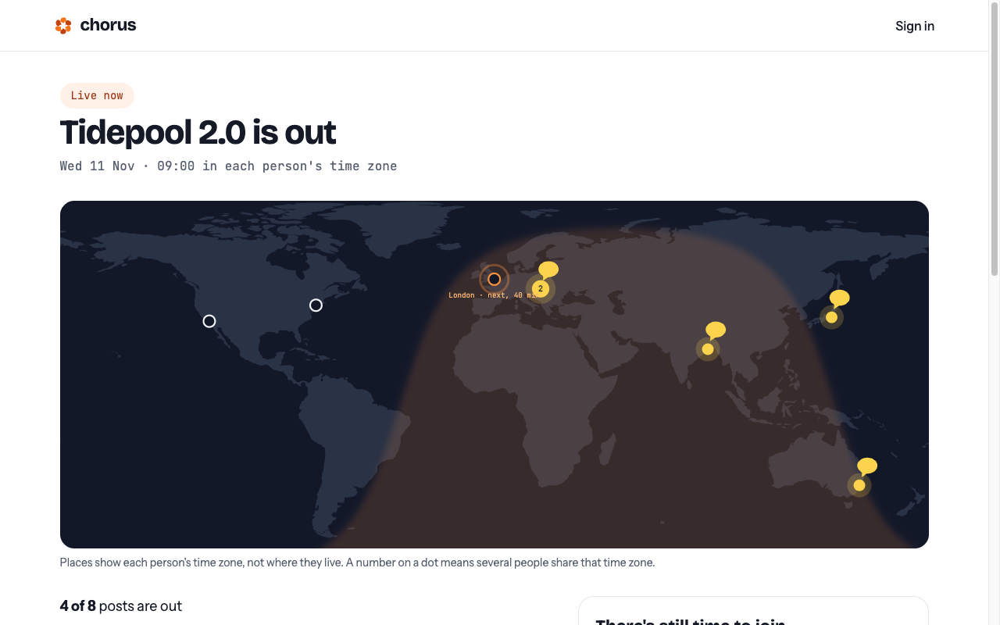
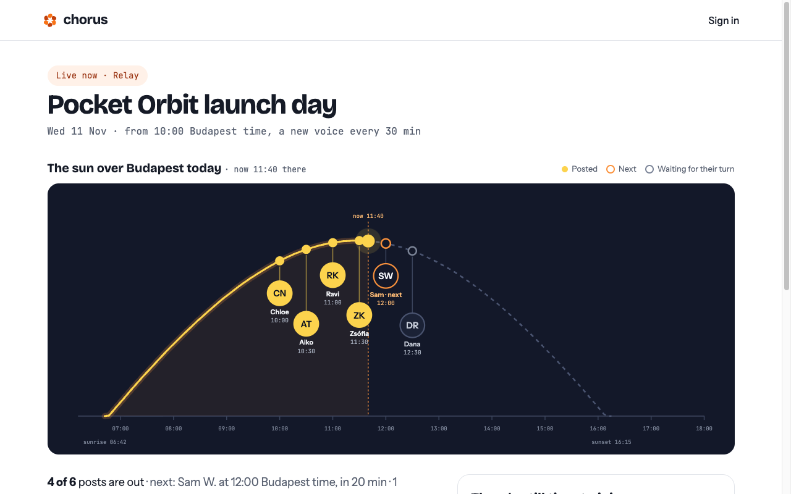

<p align="center"></p>

<h1 align="center">Chorus</h1>

<p align="center">Announce news together. Everyone writes their own post, and it goes out from their own account.</p>

<p align="center">
  <a href="https://startchorus.com">startchorus.com</a>
  <br><br>
  <a href="https://github.com/peetya/chorus/actions/workflows/ci.yml"></a>
  <a href="LICENSE.md"></a>
  
</p>



## Why

When a team, a meetup or an open source project has news, one account usually posts it and everyone else
is asked to share it. A repost with nothing of your own in it is quiet, and twenty people posting the same
sentence looks like a campaign.

Chorus lets everyone announce it together instead. Each person writes their own post, in their own words,
and it goes out from their own account. Their followers hear the news from someone they actually follow.

## How it works

1. **The organizer starts a Chorus.** What happened, the link, a fact card with the claims everyone can
   make, a few questions to help people write, and a day and a time. They share one invite link.
2. **People join and sign in with Buffer**, then pick the channel their post goes out from. Buffer's free
   plan is enough.
3. **Each person writes their own post.** Checks run while they type: the length for their network, the
   hashtag, names and numbers that aren't on the fact card, and posts that are too close to someone
   else's. Stuck? "Draft with AI" writes a first version from their own answers to the questions.
4. **They approve it, and Chorus schedules it in their own Buffer queue.** Nobody sees anyone's post before
   it goes out, and they can withdraw it until 5 minutes before.
5. **On the day, a public wall shows the posts going out** on a world map, and stays up as a finished page.

## A wave or a relay

**A wave** goes out at the same local time in each person's time zone, 09:00 by default. The news starts in
the east and travels around the world with the morning.

**A relay** is for people in one city: one voice after another through the day, a new post every 20 minutes
to an hour, along the sun's path.



## Privacy

- Chorus never posts on its own. Your post goes into your own Buffer queue, only after you approve it, and
  you can save it to your Buffer drafts instead.
- Buffer tokens are encrypted (AES-256-GCM) before they're stored, and deleted a day after your last Chorus
  is over, together with your drafts.
- The finished wall keeps only your first name and initial, the network, the time zone and the link to
  your real post.
- Pinterest, TikTok and YouTube channels can't join, because a Chorus post doesn't fit them.

## Built with

- **Node 24** runs the TypeScript directly, so there is no build step
- **Express 5**, with server-rendered HTML through a small tagged template that escapes every value
- **MongoDB** with the plain driver
- Plain CSS and a few small browser scripts, no frontend framework. Pages work without JS where they can
- **[Buffer API](https://developers.buffer.com)** (GraphQL, OAuth with PKCE) for channels, scheduling, and a note on each post that links back to its Chorus
- **OpenAI** for the optional "Draft with AI" step
- **sharp** for the image crops per network, **Vercel Blob** to host them
- **Vercel** for hosting, `node --test` for tests, **Biome** for lint and formatting

## Getting started

You need Node 24, Docker (for a local MongoDB) and [mkcert](https://github.com/FiloSottile/mkcert). Buffer
only accepts https redirect URIs, localhost too.

### Without a Buffer account (mock mode)

Mock mode signs you in as fake people in different time zones, and nothing reaches Buffer.

```bash
git clone https://github.com/peetya/chorus.git
cd chorus
npm install
cp .env.example .env   # set BUFFER_MOCK=1, and SESSION_SECRET and TOKEN_KEY to two `openssl rand -hex 32` values
mkcert -install        # once per machine
npm run cert
npm run db             # MongoDB on localhost:27017, a data browser on http://localhost:8081
npm run mock-data      # a Chorus for every state of the wall, timed around now
npm run dev            # https://localhost:3000
```

`npm run mock-data` makes waves that are coming up, live and finished, and a live, a full and a finished
relay. Run it again to reset them.

### With a Buffer account

1. Create an app client at [publish.buffer.com/settings/api](https://publish.buffer.com/settings/api) with
   the redirect URI `https://localhost:3000/callback`.
2. Put its client ID and secret in `.env`, and leave `BUFFER_MOCK` empty.
3. `npm run dev`, and sign in with your Buffer account.

`.env.example` lists every setting, with what it does.

### Scripts

| Command                          | What it does                                                |
| -------------------------------- | ----------------------------------------------------------- |
| `npm run dev`                    | Local server on https://localhost:3000, restarts on changes |
| `npm test`                       | The tests (they need `npm run db`)                          |
| `npm run typecheck`              | `tsc`, no output files                                      |
| `npm run lint`                   | Biome lint and format check                                 |
| `npm run format`                 | Biome, fixing what it can                                   |
| `npm run db` / `npm run db:stop` | Start or stop MongoDB and the data browser in Docker        |
| `npm run mock-data`              | Fill the local database for mock mode                       |

## Project structure

```
src/           the server
  pages.ts     routes for the pages (auth.ts has sign-in)
  views/       the markup of each screen
  buffer.ts    the Buffer API
  posts.ts     approving, scheduling and following each post
  checks.ts    the checks that run while you write
public/        CSS, the logo, the world map and the small browser scripts
scripts/       the mock data and the world map builder
test/          node --test tests
```

[`AGENTS.md`](AGENTS.md) explains the code in more detail, for people and for coding agents.

## Contributing

Issues and ideas are welcome. See [CONTRIBUTING.md](CONTRIBUTING.md) before you open a pull request, and
[SECURITY.md](SECURITY.md) to report a security problem privately.

## Credits

The world map uses [Natural Earth](https://www.naturalearthdata.com/) land shapes and the time zone
positions from the [tz database](https://www.iana.org/time-zones), both public domain.
`node scripts/world-map.ts` rebuilds `public/world.svg` and `src/zones.ts` from them.

The fonts are [Bricolage Grotesque](https://github.com/ateliertriay/bricolage),
[Instrument Sans](https://github.com/Instrument/instrument-sans) and
[JetBrains Mono](https://github.com/JetBrains/JetBrainsMono), under the SIL Open Font License. They are
served from `public/fonts`, with their licenses.

Chorus is an independent project. It works with Buffer's public API, but it isn't made or supported by
Buffer.

## License

[FSL-1.1-ALv2](LICENSE.md): you can read, run and change the code, but not offer it as a competing service.
Two years after each release, that release becomes Apache 2.0.
